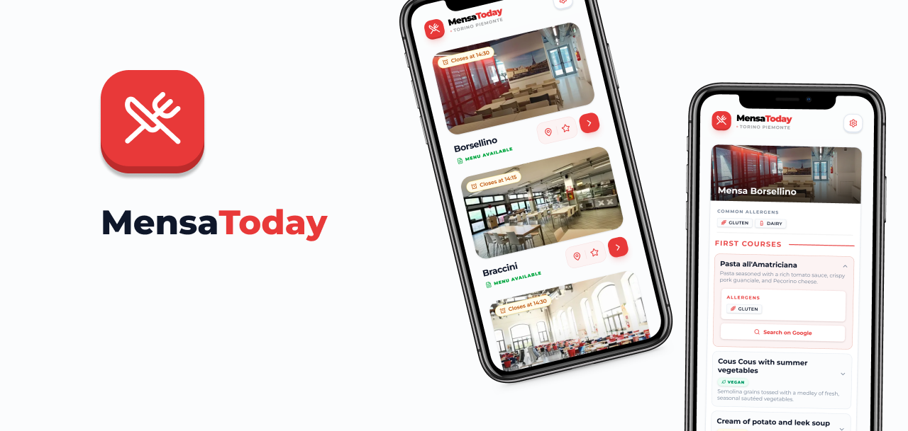
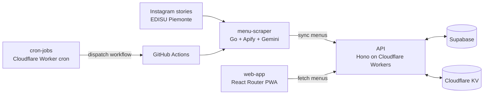

# MensaToday



MensaToday is a web app for checking daily menus at EDISU Piemonte cafeterias in Turin. It pulls menu images from Instagram stories, extracts the menu with Gemini, and shows the result in Italian, English, and Turkish.

**Live app:** [mensatoday.app](https://mensatoday.app)

I built it because checking cafeteria menus on Instagram stories was annoying, especially when the menu is only an image and not searchable or translatable.

## What it does

- Shows daily menus for EDISU Piemonte mensas, with a detail page for each location
- Translates dish names and descriptions into Italian, English, and Turkish
- Marks allergens and dietary info where available
- Supports push notifications for new menus
- Works as a PWA, so it can be installed on a phone
- Lets you star favorite mensas and keeps them at the top of the list

## How it works



The project is split into four parts:

1. **`menu-scraper/`** (Go) — Fetches Instagram stories through Apify, filters image stories, sends them to Gemini for structured extraction, then posts the parsed menu data to the API.
2. **`api/`** (Hono on Cloudflare Workers) — Stores menus in Supabase, caches responses in Cloudflare KV, handles push subscriptions, and exposes public/internal endpoints.
3. **`web-app/`** (React Router 7 + React 19) — The frontend PWA. It loads menus from the API, handles language selection, install prompts, and push notification setup.
4. **`cron-jobs/`** (Cloudflare Worker) — Triggers GitHub Actions workflows on a schedule to run the scraper and clear old menus.

## Tech stack

| Part | Stack |
|------|-------|
| Web app | React Router 7, React 19, TypeScript, Tailwind CSS 4, daisyUI, Vite, Workbox, Cloudflare Pages |
| API | Hono, TypeScript, Cloudflare Workers, Supabase, Cloudflare KV, Zod, Web Push |
| Scraper | Go 1.25, Google Gemini API, Apify, Fiber (dev server) |
| Automation | Cloudflare Workers cron, GitHub Actions, Wrangler, Bun |

## Project structure

```text
.
├── api/            # Cloudflare Worker API
├── web-app/        # React Router PWA frontend
├── menu-scraper/   # Go scraper + Gemini menu extraction
├── cron-jobs/      # Scheduled workflow dispatcher
├── .github/
│   └── workflows/  # scrape, clear, and test workflows
└── package.json    # root scripts and Bun workspaces
```

## Running locally

### Prerequisites

- [Bun](https://bun.sh/)
- [Go](https://go.dev/) 1.25+ for the scraper
- A Supabase project for the API
- API keys/credentials for Gemini, Apify, and VAPID (depending on what you want to run)

### Install

```bash
bun install
```

### Environment files

Each service has its own env file/template:

- `api/.dev.vars.sample` -> copy to `api/.dev.vars`
- `web-app/.env.sample`, with `.env.development` and `.env.production` for local/prod values
- `menu-scraper/.env` for scraper config (Gemini, Apify, sync API settings)
- `cron-jobs/.dev.vars.sample` -> copy to `cron-jobs/.dev.vars`

### Start the web app and API

From the repo root:

```bash
bun run dev
```

This runs the API and web app together through the root scripts.

You can also run them separately:

```bash
bun run dev:api
bun run dev:web
```

### Run the scraper

```bash
bun run dev:scraper
```

Or run the production sync flow from the scraper directory as described in `menu-scraper/AGENTS.md`.

### Run cron jobs locally

```bash
cd cron-jobs
bun run dev
```

Use `bun run mock` in `cron-jobs/` if you want to test dispatches against the local mock GitHub server instead of the real GitHub API.

## Notes

- The root Bun workspaces are `api` and `web-app`; the Go scraper and cron worker are managed separately.
- The API has internal endpoints protected by `X-Internal-Key` for scraper sync/clear operations.
- Menu extraction depends on external services and AI output, so the scraper includes validation and caching/dedup logic to reduce bad or repeated results.
- This is an independent project and is not affiliated with EDISU Piemonte.
